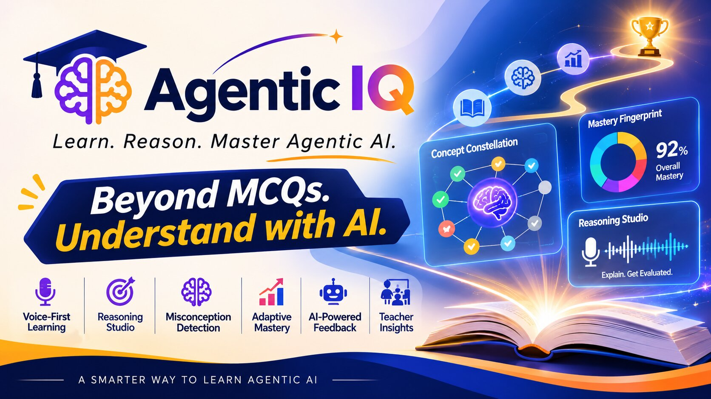

# Agentic IQ

## **Learn. Reason. Master Agentic AI.**

>### The Socratic Learning Intelligence Studio designed to take engineers from LLM fundamentals to production-grade autonomous multi-agent systems through voice-first reasoning, active misconception diagnosis, and 5-pillar cognitive calibration.

> #### 📢 Please Note: This POC version focuses on demonstrating the core capabilities with select features and content included.

## 🎥  Watch the demo to see Agentic IQ in action!
[](https://youtu.be/ONquY2pq9xw?si=0QhmyStUkEtwBOl_)

---
🌐 **Live Application:** [https://agentic-iq-beta.vercel.app](https://agentic-iq-beta.vercel.app)  
---

## Table of Contents

1. [Overview](#overview)
2. [The Core Problem](#the-core-problem)
3. [The Solution: Socratic Cognitive Calibration](#the-solution-socratic-cognitive-calibration)
4. [Studio Features](#studio-features)
   - [Student Learning Studio](#student-learning-studio)
   - [Instructor Intelligence Center](#instructor-intelligence-center)
5. [6-Stage Learning Atlas](#6-stage-learning-atlas)
6. [Technology Stack](#technology-stack)
7. [System Architecture](#system-architecture)
8. [1-Click Demo Accounts](#1-click-demo-accounts)
9. [5-Minute Demo Walkthrough](#5-minute-demo-walkthrough)
10. [Local Development Setup](#local-development-setup)
11. [Environment Variables](#environment-variables)
12. [Vercel Deployment](#vercel-deployment)
---

## Overview

Traditional learning platforms measure whether engineers can recognize the correct option in a multiple-choice quiz. But designing and debugging **production Agentic AI systems** requires architectural intuition, failure mode anticipation, trade-off reasoning, and execution-loop discipline.

**Agentic IQ** bridges the gap between passive consumption and architectural mastery. Learners explain systems concepts orally or in text, and our **Groq-powered LPU reasoning engine** probes their arguments, extracts flawed mental models, updates a calibrated **5-pillar cognitive fingerprint**, and dynamically adapts their curriculum.

---

## The Core Problem

* **Superficial Knowledge Illusion**: Engineers memorize buzzwords (ReAct, LangGraph, Multi-Agent Swarms, RAG) and pass static quizzes with 80%+ scores while harboring critical misconceptions that fail in production.
* **Passive Consumption**: Reading documentation does not train developers to catch subtle agent execution bugs like non-terminating tool loops, KV-cache context saturation, or prompt injection egress.
* **Faculty Blindspots**: Instructors have no visibility into the class-wide mental models of their cohort until students fail their capstones or production deployments.

---

## The Solution: Socratic Cognitive Calibration

Agentic IQ evaluates **reasoning depth**, not superficial keyword recognition:

1. **Oral / Written Explanation**: Learners articulate system trade-offs using browser-native **Web Speech API** dictation or text.
2. **AI Socratic Evaluation**: Groq LPU inference (`llama-3.3-70b-versatile`) evaluates conceptual coherence, identifies missing edge-cases, and isolates specific misconceptions.
3. **5-Pillar Calibration**: Mastery is updated using a weighted Bayesian formula: 70% oral reasoning weight + 30% diagnostic check weight.
4. **Targeted Adaptation**: The platform surfaces instant spoken audio feedback and schedules spaced repetition drills for flagged misconceptions.

---

## Studio Features

### Student Learning Studio
* **Cognitive Command Center (`/dashboard`)**: Live view of current mastery calibration, active misconception alerts, cognitive archetypes (*e.g., Deliberate Builder, Systems Architect*), and prioritized next-action recommendations.
* **Learning Atlas (`/curriculum/[moduleId]`)**: 6 interactive stages containing 24 comprehensive concepts. Each lesson provides real-world engineering analogies, architecture breakdowns, production code, key takeaways, and **Web Speech API audio narration**.
* **Concept Constellation (`/roadmap`)**: Interactive SVG topological dependency graph modeling prerequisites, mastery status (*Mastered, Proficient, Developing, Beginner*), and interactive concept inspection drawers.
* **Voice Reasoning Studio (`/assessment/diagnostic`)**: Voice-first oral reasoning evaluations where learners debate and justify system architectures to AI evaluators.
* **Socratic AI Tutor (`/tutor`)**: Conversational AI mentor designed to guide learners with Socratic questions rather than revealing direct answers.
* **Spaced Revision Center (`/revisions`)**: Spaced repetition drills that resurface identified misconceptions before they solidify.

### Instructor Intelligence Center
* **Class Analytics & Misconception Radar (`/teacher/dashboard`)**: High-level cohort metrics (average class mastery: 69%), active misconception count, and the **Class-Wide Misconception Radar** tracking flawed mental models across student submissions with 1-click broadcast studio drill capabilities.
* **Student Intelligence Directory (`/teacher/students`)**: Unified 6-learner cohort table with real-time text search, cognitive status filter tabs (*Advanced, On Track, Needs Support*), and non-overlapping horizontal scroll-safe layout.
* **Learner Cognitive Audit (`/teacher/students/[studentId]`)**: Granular audit view for each learner featuring:
  - **5-Pillar Mastery Fingerprint**:
    1. *Conceptual Foundations*
    2. *Implementation Fluency*
    3. *Failure & Self-Correction*
    4. *Trade-off Analysis*
    5. *Tool & Schema Design*
  - Diagnosed misconception cards with severity tags (*High, Medium, Low*).
  - Chronological reasoning trajectory history.

---

## 6-Stage Learning Atlas

The curriculum covers 24 in-depth architectural concepts across 6 progressive stages:

| Stage | Focus Area | Concepts Covered |
| :---: | :--- | :--- |
| **01** | **LLM Foundations** | Tokens & Embeddings, Context Windows & KV-Cache, Attention Mechanism, Hallucinations & Grounding |
| **02** | **Agent Fundamentals** | The ReAct Loop, Structured Tool Calling, Planning & Goal Decomposition, Halting Criteria & Budgeting |
| **03** | **Agent Architecture** | Short & Long-Term Memory, Cyclical State Graphs, Reflection & Metacognition, Self-Correction & Recovery |
| **04** | **Agent Orchestration** | Supervisor & Hierarchical Agents, Multi-Agent Swarms, Broadcast & Consensus Protocols, Task Hand-off & Context Routing |
| **05** | **Production Agents** | Human-in-the-Loop Safeguards, Sandboxing & Tool Security, Observability & Tracing, Reliability & Retry Fallbacks |
| **06** | **Evaluation & Benchmarks** | LLM-as-a-Judge Evaluation, Benchmarks & Agentic Evals, Red-Teaming & Prompt Injections, Continuous Cognitive Profiling |

---

## Technology Stack

| Layer | Technology | Details |
| :--- | :--- | :--- |
| **Framework** | **Next.js 16** (App Router) | Turbopack engine, Partial Prefetching (PPR), Edge Proxy Middleware |
| **Language** | **TypeScript** | Strict type-safety across all routes, models, and components |
| **Styling** | **Tailwind CSS v4** | Custom warm-ivory editorial design system (`bg-warm-ivory`, `electric-indigo`) |
| **AI Inference** | **Groq LPU Cloud** | `llama-3.3-70b-versatile` / `gpt-oss-120b` for sub-3s Socratic evaluation |
| **Voice & Audio** | **Web Speech API** | Client-side native SpeechRecognition (dictation) & SpeechSynthesis (narration) |
| **Auth & Database** | **Supabase** | Supabase SSR Auth with role-based `user_metadata`, PostgreSQL + RLS |
| **Icons** | **Lucide React** | Clean studio iconography |
| **Deployment** | **Vercel** | Edge network deployment with automated GitHub CI/CD pipeline |

---

## System Architecture

For in-depth architectural specifications, see [docs/architecture/ARCHITECTURE.md](docs/architecture/ARCHITECTURE.md).

```
┌─────────────────────────────────────────────────────────────┐
│                     Next.js 16 (Vercel)                     │
│                                                             │
│  ┌─────────────────────────┐   ┌──────────────────────────┐ │
│  │   Student Learning      │   │   Proxy Middleware       │ │
│  │   & Teacher Portals     │──▶│   (src/proxy.ts)         │ │
│  └─────────────────────────┘   └────────────┬─────────────┘ │
│                                             │               │
│               ┌─────────────────────────────┼────────┐      │
│               │                             │        │      │
│        ┌──────▼──────┐               ┌──────▼──────┐ │      │
│        │ Supabase    │               │ Groq AI API │ │      │
│        │ Auth + SSR  │               │ Llama 3.3   │ │      │
│        │ PostgreSQL  │               │ 70B Engine  │ │      │
│        └─────────────┘               └─────────────┘ │      │
└─────────────────────────────────────────────────────────────┘
```

---

## 1-Click Demo Accounts

The live login page at [https://agentic-iq-beta.vercel.app/login](https://agentic-iq-beta.vercel.app/login) includes **1-Click Demo Access buttons** for immediate evaluation:

| Role | Name | Email | Password | Landing Page |
| :--- | :--- | :--- | :--- | :--- |
| **Student** | Alex Chen | `student@agenticiq.demo` | `AgenticIQ_Student2026!` | `/dashboard` |
| **Teacher** | Dr. Evelyn Reed | `teacher@agenticiq.demo` | `AgenticIQ_Teacher2026!` | `/teacher/dashboard` |

---

## 5-Minute Demo Walkthrough

1. **Open the Login Portal**  
   Navigate to [https://agentic-iq-beta.vercel.app](https://agentic-iq-beta.vercel.app). Unauthenticated visitors are automatically routed to the Login & Demo selection screen.
2. **Enter the Student Learning Studio**  
   Click **"Student Demo"** (1-click login as Alex Chen).
3. **Explore the Command Center**  
   Review the active mastery trajectory, diagnosed cognitive archetype, and active misconception alert.
4. **Inspect the Learning Atlas**  
   Click **"Learning Atlas"** in the sidebar. Switch between Stage 01 (*LLM Foundations*) through Stage 06 (*Evaluation & Benchmarks*). Click any concept (*e.g., Tokens & Embeddings*) to review analogy breakdowns and test the Web Speech audio narration.
5. **Explore the Concept Constellation**  
   Click **"Concept Constellation"** in the sidebar to interact with the SVG topological knowledge graph and inspect prerequisite dependencies.
6. **Launch Voice Reasoning Studio**  
   Navigate to **Reasoning Studio** (`/assessment/diagnostic`). Complete the conceptual probe, then click **"Simulate Voice Input"** (or use your microphone) to submit an architectural explanation and watch Groq AI evaluate reasoning depth in real time.
7. **Switch to Instructor Intelligence Center**  
   Click **Sign Out** and click **"Teacher Demo"** (1-click login as Dr. Evelyn Reed).
8. **Audit Cohort Analytics**  
   Review the enrolled 6-learner cohort, class average mastery (69%), and examine the **Misconception Radar**.
9. **Inspect the Student Directory**  
   Click **"Student Directory"** to test real-time search and status filters across all 6 learners.
10. **Run a Learner Cognitive Audit**  
    Click **"Audit"** next to *Alex Rivera* or *Casey Thompson* to inspect their 5-pillar mastery fingerprints and diagnosed misconception history.

---

## Local Development Setup

### Prerequisites
- Node.js 20+ (`node -v`)
- npm or pnpm
- Supabase project
- Groq API key

### Steps

```bash
# 1. Clone the repository
git clone https://github.com/SK7Cosmo/Agent-IQ.git
cd Agent-IQ

# 2. Install dependencies
npm install

# 3. Configure environment variables
cp .env.example .env.local
# Add your Supabase URL, publishable key, service role key, and Groq API key

# 4. Provision demo accounts
node scripts/setup-demo-accounts.mjs

# 5. Start the Next.js development server
npm run dev
```

Open [http://localhost:3000](http://localhost:3000) in your browser.

---

## Environment Variables

| Variable | Description | Required |
| :--- | :--- | :---: |
| `NEXT_PUBLIC_SUPABASE_URL` | Supabase project URL | ✅ |
| `NEXT_PUBLIC_SUPABASE_PUBLISHABLE_KEY` | Supabase publishable (anon) key | ✅ |
| `SUPABASE_SERVICE_ROLE_KEY` | Supabase service role key (server-side only) | ✅ |
| `GROQ_API_KEY` | Groq API key for LPU reasoning inference | ✅ |
| `GROQ_MODEL` | Default model (e.g. `llama-3.3-70b-versatile` or `openai/gpt-oss-120b`) | Optional |
| `GROQ_BASE_URL` | Groq endpoint (default: `https://api.groq.com/openai/v1`) | Optional |

---

## Vercel Deployment

The application is deployed to production on Vercel with automated continuous deployment on pushes to `main`:

* **Live URL:** [https://agentic-iq-beta.vercel.app](https://agentic-iq-beta.vercel.app)
* **Build Command:** `next build` (Next.js 16 Turbopack)
* **Proxy Configuration:** Managed via `src/proxy.ts`


